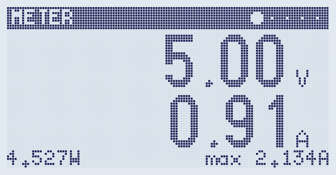
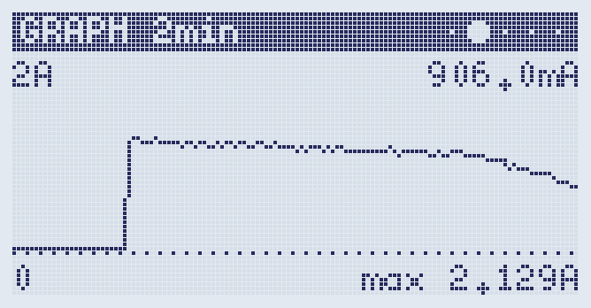
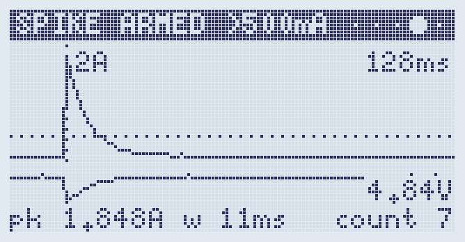
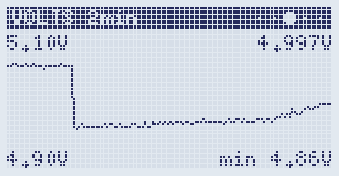
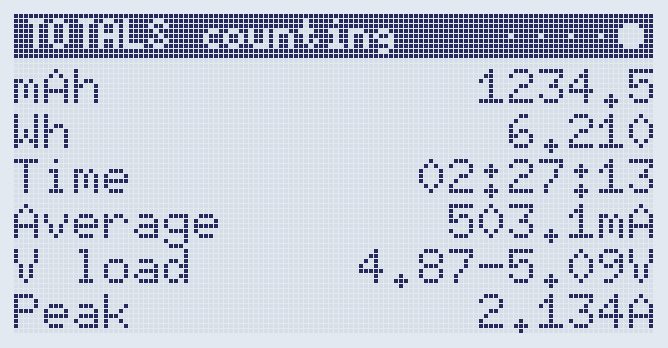
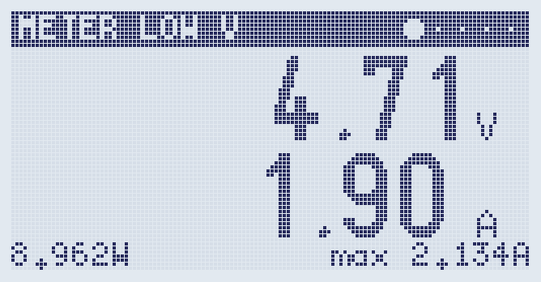
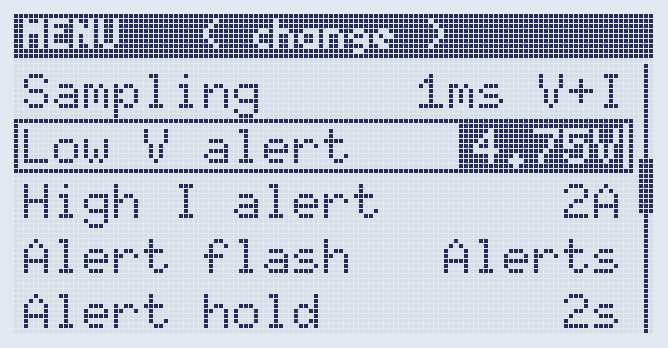

# STM32 USB Power Meter

An inline power meter for a USB hub (or anything else on a 5 V rail), built from a bare
**STM32F051K8T6**, an **INA219** with a 10 mΩ high-side shunt, an **ST7567 128×64 LCD**, and a
3-way joystick. It samples the current every millisecond in a timer interrupt, so it catches
inrush spikes and voltage dips that a typical USB meter averages away.

<p align="center">
  
  
  
</p>

## Features

- **Volts, amps, watts and peak** on large digits, 1–3 decimals selectable.
- **1 ms sampling** of the current in a timer interrupt (0.5 ms in fast mode). The bus voltage is
  read with every sample too, so voltage sag under load is measured, not guessed.
- **Spike capture**: a trigger at a level you choose freezes 128 samples (16 before the trigger),
  current and voltage together, and measures the peak and the width of the spike.
- **History graphs** of current and voltage, 6.4 s to 64 min across the screen.
- **Totals**: mAh, Wh, time under load, average current, voltage range under load, peak.
  Saved to flash, and saved again the moment the supply starts to fail.
- **Alerts** for low voltage and high current, checked on every single sample, shown in the
  header and, if you like, as **fast flashing of the backlight**. Optional latching until a
  button is pressed.
- **Backlight dimming** after a period without a button press.
- **Idle reset**: a load that starts after a chosen idle time starts a new session.
- Settings and totals in flash as **wear-levelled record logs**; a watchdog; the last page is
  remembered across power cycles.
- Selectable shunt (R010 / R100 / R001), range, gain calibration and zero offset.

## Screens

Left and right switch pages. The pictures below are rendered from the real drawing code
(see [Regenerating the screenshots](#regenerating-the-screenshots)).

| | |
|---|---|
|  |  |
| **METER**: voltage, current, power and the peak current. | **GRAPH**: average current, newest on the right. Scale top and the current now above; the highest peak on the screen below. |
|  |  |
| **VOLTS**: average voltage history, scaled to at least 200 mV. The lowest single reading on the screen is shown below; a dashed line marks the low-voltage alert level. | **SPIKE**: the last triggered capture. Current on top with the trigger level dotted, the bus voltage during the same 128 ms below it, with its minimum. Peak, width and the number of spikes at the bottom. |
|  |  |
| **TOTALS**: charge, energy, time under load, average, voltage range under load, peak. | **Alert**: the header blinks LOW V / HIGH I (and the backlight can flash). |



## Hardware

| Part | Notes |
|---|---|
| STM32F051K8T6 (LQFP32) | 64 KB flash, 8 KB RAM. Runs at 48 MHz from the internal oscillator, no crystal. No USB. |
| INA219 | The bare chip. A0 and A1 to GND (address 0x40; the firmware scans 0x40–0x4F). |
| Shunt R010 (10 mΩ) | High-side, on the 5 V line. |
| ST7567 128×64 LCD | SPI, U8g2 driver `ST7567_JLX12864`. |
| 3-way joystick | Left, center (push), right. Each to GND, internal pull-ups. |
| AMS1117-3.3 | 3.3 V for the MCU, INA219 and LCD. |
| ST-Link | SWD programming. |

### Wiring

| Signal | STM32 pin |
|---|---|
| LCD CS / DC / RST | PA4 / PB0 / PB1 |
| LCD SCK / SDA (MOSI) | PA5 / PA7 (SPI1) |
| LCD backlight LED cathode | PA11 (TIM1_CH4 PWM), active low, open-drain |
| INA219 SCL / SDA | PB6 / PB7 (I2C1), 4.7 kΩ pull-ups to 3.3 V |
| Joystick left / center / right | PA0 / PA1 / PA2 |
| ST-Link SWDIO / SWCLK | PA13 / PA14 (plus GND, 3.3 V, and NRST if connecting fails) |
| BOOT0 | GND |

**Current path:** 5 V supply → VIN+ → R010 → VIN- → hub. The hub's GND returns straight to the
supply, and all grounds are common. The bus voltage is measured from VIN- to GND, which is the
voltage the hub actually gets. A negative current means VIN+ and VIN- are swapped.

**INA219 VS** goes to 3.3 V: it has to match the logic level.

**Capacitors**

- STM32: 100 nF on each VDD (pins 1 and 17), 4.7 µF shared, 100 nF + 1 µF on VDDA (pin 5),
  optional 100 nF on NRST.
- INA219: 100 nF on VS.
- AMS1117: 10 µF in, 10–22 µF out.
- **No** RC filter on VIN+/VIN-, and no large capacitor after the shunt. Both would smooth away
  the spikes this meter is built to see.

> **Backlight:** on this board the LED has no series resistor, so the firmware caps the PWM duty
> at 25 % (`BL_MAX_PWM=64` in `platformio.ini`). Do not raise it without adding a resistor.

### Choosing a shunt

The INA219 measures the shunt voltage in 10 µV steps whatever the gain; the gain (PGA) only sets
the range. The current is computed in firmware from the raw shunt reading, so the shunt is a menu
setting:

| Shunt | Default range | Resolution | Use |
|---|---|---|---|
| R010 (10 mΩ) | ±80 mV → 8 A | 1 mA | USB hubs and chargers: the default |
| R100 (100 mΩ) | ±320 mV → 3.2 A | 0.1 mA | small loads |
| R001 (1 mΩ) | ±40 mV → 40 A | 10 mA | tens of amps only: the INA219 offset alone is 50–100 mA here |

For more resolution, the INA226 (16-bit, 2.5 µV steps, lower offset, up to 36 V) is a natural upgrade.

## Building and flashing

[PlatformIO](https://platformio.org/) with the Arduino framework (STM32duino) and U8g2.

```sh
pio run              # build
pio run -t upload    # flash over ST-Link
```

- The platform is pinned to **`ststm32@19.7.1`** (Arduino core 2.12), the version tested on the
  hardware. Newer platforms bring core 3.0, and a build from it did not run on this board.
- PlatformIO has no board for this chip, so [boards/genericSTM32F051K8.json](boards/genericSTM32F051K8.json)
  defines one, and [boards/ldscript_f051x8.ld](boards/ldscript_f051x8.ld) supplies the linker
  script the core's `F051K(6-8)T` variant lacks.
- The variant leaves `SystemClock_Config()` empty and the build prints a `#warning` about it.
  That is expected: [include/hw.h](include/hw.h) provides the real one (HSI/2 × 12 = 48 MHz).
- `board_upload.maximum_size` keeps the last 2 KB of flash for the settings and totals.
- Current build: about 44 KB of 62 KB flash and 4.9 KB of 8 KB RAM.

## Using it

| Control | Action |
|---|---|
| Left / right | Previous / next page |
| Center click | Open the menu |
| Center hold | Quick action: METER resets the peaks, GRAPH and VOLTS change the time span, SPIKE arms the trigger, TOTALS resets the totals |
| In the menu | Left / right move, center selects or starts editing (then left / right change the value), hold center to leave |

While the backlight is dimmed, or an alert is latched, the first press only wakes the light or
clears the alert.

### Menu

| Item | Values | |
|---|---|---|
| Zero current | | Stores the zero offset. Only with no load connected. |
| Arm trigger | | Arms the spike capture and opens the SPIKE page. |
| Reset peaks / Reset totals | | |
| Graph span | 6.4 s, 26 s, 2 min, 11 min, 64 min | Time across the screen on GRAPH and VOLTS |
| Trigger | 5 mA … 5 A | Spike capture level |
| Trigger mode | Auto / Single | Auto re-arms after every capture |
| Sampling | 1 ms V+I / 0.5 ms I | At 0.5 ms only the current is measured; the voltage is held (an "h" on METER) |
| Low V alert | Off, 3.00–5.50 V in 50 mV steps, then up to 20 V | |
| High I alert | Off, 5 mA … 5 A | |
| Alert flash | Off / Alerts / All | *All* also flashes on overload, a lost sensor and a finished single capture |
| Alert hold | 2s / Latch | Latch keeps the alert until a button is pressed |
| Idle reset | Off / 1 min / 10 min / 1 h | A load starting after this idle time starts a new session |
| Shunt | R010 / R100 / R001 | |
| Range | depends on the shunt | INA219 PGA: ±40, 80, 160 or 320 mV |
| Current cal | ±20.0 % in 0.1 % steps | Gain correction against a trusted meter |
| Volt digits / Amp digits | 1–3 | Decimals on METER |
| Contrast | 0–254 | |
| Backlight | 0–10 | |
| Dim after | Never, 30 s, 1 min, 5 min, 15 min | |
| Display | Normal / Mirror / Turn 180 / Mirror V | Pick whatever matches how the LCD is mounted |

## How it works

**Sampling.** TIM3 fires every 1000 µs (500 µs in fast mode), a little faster than the INA219's
1064 µs conversion pair (532 µs in shunt-only mode), so no conversion is missed. The interrupt
reads the shunt register over a polled, register-level I2C driver (no Wire, no I2C interrupts),
so it is safe inside the interrupt. At 400 kHz the bus voltage is read with every sample, about
0.25 ms of I2C per tick; on a 100 kHz fallback, every 16th sample. The interrupt keeps the sum,
minimum and maximum of each window; the main loop collects them every 10 ms.
Rule: the main loop may only use I2C while the sampler is stopped.

**Spike capture.** While armed, the interrupt writes current and voltage into a 128-sample ring
buffer. A rising edge through the trigger level (with 1/8 hysteresis) starts the post-trigger
count; 16 samples from before the trigger are kept.

**Alerts** look at the minimum voltage and the peak current of each window, so a single 1 ms
sample beyond the threshold is enough. Note that the high-current alert therefore also sees
plug-in inrush.

**Flash storage.** The last two 1 KB pages hold the settings and the totals, each as a log of
records: every save goes to the next free slot, and a page is erased only once it is full
(36 settings records, 30 totals records). A marker written last makes a record that was cut short
by a power loss invisible. Totals are saved every 2 minutes if at least 1 mAh was added, and the
page shown is remembered once it has been on screen for 10 s.

**Power loss.** When the bus voltage drops below 4.4 V, the interrupt cuts the backlight on the
spot (the pin becomes an input) and the main loop writes a totals record, which takes well under
1 ms. It re-arms above 4.6 V, at most once every 10 s. How long the 3.3 V rail lasts depends on
the capacitors, so this is a best effort; a diode and a few hundred µF ahead of the regulator,
which the hub cannot drain, make it reliable. Not active at 0.5 ms sampling.

**Watchdog.** The independent watchdog resets the MCU after about 2 s without the main loop;
"Watchdog reset" is shown after such a restart.

## Regenerating the screenshots

[tools/screenshots](tools/screenshots) compiles `src/main.cpp` on the PC against the U8g2 C
library, with small stand-in headers for the hardware, draws every page with sample data, and
writes the PNGs to [docs/screenshots](docs/screenshots):

```sh
pio run                              # once, to download U8g2
pip install pillow
python tools/screenshots/make.py     # finds PlatformIO's MinGW g++ on Windows, or pass --gxx
```

## Repository layout

```
src/main.cpp          pages, menu, buttons, alerts, backlight
include/hw.h          pins, clock, backlight, watchdog
include/ina219.h      I2C driver, sampling interrupt, spike capture
include/store.h       flash record logs: settings and totals
boards/               board definition and linker script for the STM32F051K8
tools/screenshots/    PC renderer for the README images
```

## License

[MIT](LICENSE)
